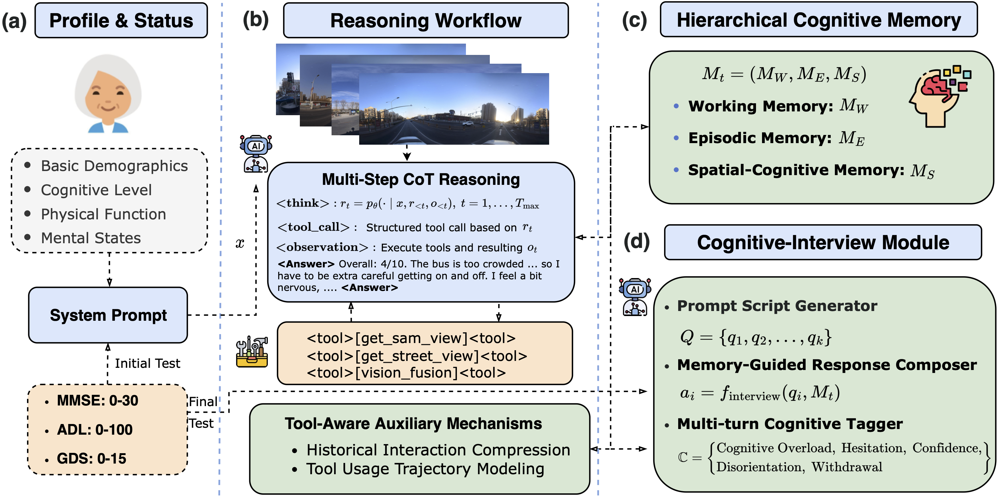

# MobCog: Multimodal Agent Modeling of Cognitive Load in Elderly Urban Mobility

## Overview

<p align="center"></p>

As populations age, older adults face increasing challenges in navi-
gating complex urban transit systems, yet existing planning and
navigation tools often underestimate the cognitive load induced by
multimodal networks, frequent transfers, and time pressure. This
limitation makes it difficult to capture route deviations, trip aban-
donment, and resulting mobility inequities among older travelers
with heterogeneous health and cognitive conditions. To address this,
we propose **MobCog**, a multimodal agent-based framework
for modeling cognitive load in elderly urban mobility. Guided by a
three-dimensional framework of **Accessibility**, **Comprehensibility**,
and **Cognitive Resilience (ACC)**, MobCog formalizes travel
as a closed-loop decision cycle encompassing perception, cognition,
and action. Powered by a multimodal large model with chain-of-
thought reasoning, the framework integrates visual, linguistic, and
spatial cues encountered along the journey. A hierarchical cog-
nitive memory system and cognitive-interview module generate
introspective, structured “inner monologues”, while a tool-aware
auxiliary mechanism compresses multimodal interaction histories
to produce coherent post-trip behavioral narratives. 

## Setup

To set up CityCogAgent, clone this repository and install the required dependencies:
```
cd CityCogAgent
conda create --name CityCogAgent python=3.11.0
conda activate CityCogAgent
pip install -r requirements.txt
```
Ensure you have access to OpenAI’s API for language model inference.

## Usage


The pipeline consists of two stages:

1. **MobCog simulation** – run the elderly MobCog on all trips and log step-wise reasoning, tool use, and memory state.
2. **Cognitive-Interview** – run post-task interviews on the saved simulation logs to obtain subjective, memory-guided narratives.

---

### 1 Running MobCog

This step generates the main simulation file `results/simulation_outputs.jsonl`, which will later be used by the Cognitive-Interview module.

#### Arguments

| Argument            | Default                                           | Description                                                                 |
| ------------------- | ------------------------------------------------- | --------------------------------------------------------------------------- |
| `--persona_file`    | `config/personas/elder_personas.json`        | Path to the elder personas JSON file.                                      |
| `--trips_file`      | `data/trip_data.json`                     | Path to the preprocessed trip dataset.                                     |
| `--streetview_file` | `data/station_sv_map_nearest10.json` | Station–street-view mapping file.                                          |
| `--output_file`     | `results/simulation_outputs.jsonl`               | Output path for simulation results (one JSON object per line).             |
| `--persona_id`      | *None*                                           | Persona ID to use (e.g., `P1`). If omitted, a persona is chosen at random. |
| `--model`           | `/model/Qwen/Qwen2.5-VL-7B-Instruct`          | LVLM model name or path used by the agent.                                 |
| `--vllm_endpoint`   | `http://localhost:8000/v1`                       | vLLM/OpenAI-compatible HTTP endpoint.                                      |
| `--image_base_path` | `/data/imgs`                      | Base directory of street-view / community images.                          |

#### Example

```bash

python main.py \
  --persona_file /personas/elder_personas_P1-P8.json \
  --trips_file data/trip_data.json \
  --streetview_file data/station_sv_map_nearest10.json \
  --output_file results/simulation_outputs.jsonl \
  --persona_id P1 \
  --model /Qwen/Qwen2.5-VL-7B-Instruct \
  --image_base_path /data/imgs
```

### 2 Cognitive-Interview

#### Example

```
python CognitiveInterview/interview_test.py \
  --input_file results/simulation_outputs.jsonl \
  --output_dir results/interviews \
  --max_per_pattern 100
```


